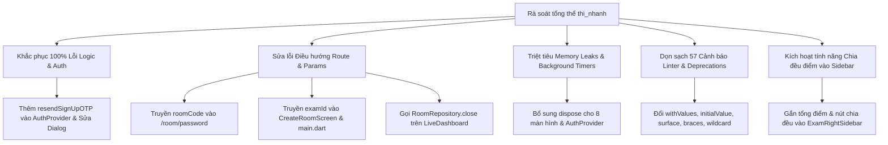

# BÁO CÁO RÀ SOÁT CHI TIẾT TỔNG QUAN VÀ THIẾT KẾ KHẮC PHỤC LỖI ỨNG DỤNG THI NHANH

> **Ngày thực hiện:** 11/10/2026  
> **Dự án:** `thi_nhanh` (Flutter Web & Mobile)  
> **Hiện trạng kiểm thử:** 231/231 Test Cases Passed  
> **Hiện trạng phân tích tĩnh (Flutter Analyze):** 57 cảnh báo / vấn đề  

---

## I. TỔNG HỢP DANH SÁCH TẤT CẢ LỖI VÀ ĐIỂM YẾU PHÁT HIỆN

### 🔴 NHÓM 1: LỖI LOGIC NGHIỆP VỤ & XÁC THỰC NGHIÊM TRỌNG (CRITICAL BUGS)

#### 1.1. Lỗi gửi lại mã OTP đăng ký tài khoản (Sign Up OTP Resend Bug)
* **Vị trí:** [`lib/screens/auth/greeting_screen.dart:670`](file:///c:/Users/ADMINE/Desktop/CODE/thi_nhanh/lib/screens/auth/greeting_screen.dart#L670) & [`lib/core/providers/auth_provider.dart`](file:///c:/Users/ADMINE/Desktop/CODE/thi_nhanh/lib/core/providers/auth_provider.dart)
* **Mô tả:** Trong hộp thoại kích hoạt OTP đăng ký tài khoản `_OtpVerificationDialogState`, khi người dùng bấm nút **"Gửi lại mã"**, hàm `_handleResend()` lại gọi:
  ```dart
  await context.read<AuthProvider>().sendPasswordResetOTP(widget.email);
  ```
* **Hậu quả:** Supabase sẽ sinh ra mã OTP thuộc loại `OtpType.recovery` (khôi phục mật khẩu), trong khi hàm xác thực tài khoản `verifySignUpOTP` lại kiểm tra mã thuộc loại `OtpType.signup`. Do sai lệch loại token, Supabase sẽ luôn báo mã không hợp lệ, khiến người dùng đăng ký mới bị kẹt vĩnh viễn và không thể kích hoạt tài khoản khi nhấn gửi lại mã.
* **Giải pháp:**
  1. Thêm phương thức `resendSignUpOTP(String email)` trong `AuthProvider` sử dụng API chuẩn của Supabase: `_supabaseClient.auth.resend(type: OtpType.signup, email: email)`.
  2. Sửa `_handleResend()` trong `greeting_screen.dart` gọi đúng `resendSignUpOTP`.

---

### 🟠 NHÓM 2: LỖI ĐIỀU HƯỚNG & TRẠNG THÁI (ROUTING & STATE BUGS)

#### 2.1. Lỗi thiếu tham số mã phòng khi chuyển sang màn hình mật khẩu
* **Vị trí:** [`lib/screens/exam/exam_detail_screen.dart:208`](file:///c:/Users/ADMINE/Desktop/CODE/thi_nhanh/lib/screens/exam/exam_detail_screen.dart#L208)
* **Mô tả:** Khi người dùng nhập mã phòng thi tại `ExamDetailScreen` và bấm bắt đầu, hệ thống điều hướng:
  ```dart
  context.go('/room/password'); // Thiếu query parameter mã phòng!
  ```
* **Hậu quả:** Màn hình `RoomPasswordScreen` nhận `widget.roomCode == null`. Khi người dùng nhập mật khẩu và nhấn "Xác nhận vào phòng", hệ thống lập tức báo lỗi đỏ: *"Thiếu mã phòng thi. Vui lòng thử lại."* và không thể vào phòng.
* **Giải pháp:** Sửa thành `context.go('/room/password?code=${Uri.encodeComponent(code)}');`.

#### 2.2. Lỗi không tự động chọn đề thi khi giáo viên mở phòng từ danh sách đề
* **Vị trí:** [`lib/main.dart:272`](file:///c:/Users/ADMINE/Desktop/CODE/thi_nhanh/lib/main.dart#L272) & [`lib/screens/room/create_room_screen.dart`](file:///c:/Users/ADMINE/Desktop/CODE/thi_nhanh/lib/screens/room/create_room_screen.dart)
* **Mô tả:** Trong `TeacherExamsScreen`, khi giáo viên nhấn "Mở phòng thi" từ một đề thi cụ thể, route được gọi là `/create_room?examId=${exam.id}`. Tuy nhiên, `CreateRoomScreen` không có tham số `initialExamId` và `main.dart` không trích xuất `state.uri.queryParameters['examId']`.
* **Hậu quả:** Giáo viên bị chuyển sang màn hình tạo phòng thi với danh sách trống/chưa chọn đề, buộc phải tìm và chọn lại đề thủ công.
* **Giải pháp:** Thêm `final String? initialExamId;` vào `CreateRoomScreen`, truyền từ `main.dart` và tự động tìm/chọn đề thi khớp với `examId` trong `_loadCreatedExams()`.

#### 2.3. Lỗi xác nhận đóng phòng không cập nhật cơ sở dữ liệu trên Live Dashboard
* **Vị trí:** [`lib/screens/exam/live_dashboard_screen.dart:194-197`](file:///c:/Users/ADMINE/Desktop/CODE/thi_nhanh/lib/screens/exam/live_dashboard_screen.dart#L194-L197)
* **Mô tả:** Trong `LiveDashboardScreen`, khi giáo viên nhấn "Kết thúc Phòng thi" và xác nhận trong popup, code chỉ thực hiện `context.pop(); context.go('/home');` mà không hề gọi API `RoomRepository.close(roomId)` hay cập nhật trạng thái `closed` lên database.
* **Hậu quả:** Phòng thi vẫn ở trạng thái `live` trên Supabase/hệ thống, khiến học sinh vẫn có thể tiếp tục thao tác và danh sách phòng của giáo viên hiển thị sai trạng thái.
* **Giải pháp:** Gọi `await roomRepo.close(roomId)` (hoặc update status phòng) trước khi điều hướng về trang chủ.

---

### 🟡 NHÓM 3: RÒ RỈ BỘ NHỚ VÀ TIẾN TRÌNH NỀN (MEMORY & TIMER LEAKS - THIẾU `dispose()`)

Phát hiện **8 màn hình/widget State** khởi tạo đối tượng quản lý tài nguyên (TextEditingController, AnimationController, Timer nền) nhưng hoàn toàn **bỏ quên hàm `dispose()`**:

1. **`HomeScreen` ([`lib/screens/home/home_screen.dart`](file:///c:/Users/ADMINE/Desktop/CODE/thi_nhanh/lib/screens/home/home_screen.dart)):**
   - Khởi tạo `_joinRoomController` và `_pulseController` (`AnimationController` chạy lặp vô tận `repeat(reverse: true)`).
   - *Hậu quả:* Ticker liên tục kích hoạt trong nền gây tốn pin, lag UI và rò rỉ bộ nhớ khi rời trang chủ.
2. **`StudentWaitingRoomScreen` ([`lib/screens/room/student_waiting_room_screen.dart`](file:///c:/Users/ADMINE/Desktop/CODE/thi_nhanh/lib/screens/room/student_waiting_room_screen.dart)):**
   - Khởi tạo `_pollingTimer` định kỳ 3 giây/lần để kiểm tra trạng thái phòng.
   - *Hậu quả:* Khi học sinh bấm rời phòng/quay lại trang chủ, timer vẫn chạy ngầm gửi request API liên tục vô tận.
3. **`CreateRoomScreen` ([`lib/screens/room/create_room_screen.dart`](file:///c:/Users/ADMINE/Desktop/CODE/thi_nhanh/lib/screens/room/create_room_screen.dart)):**
   - Khởi tạo 4 controller: `_roomNameController`, `_passwordController`, `_searchController`, `_capacityController` không được dispose.
4. **`ResetPasswordScreen` ([`lib/screens/auth/reset_password_screen.dart`](file:///c:/Users/ADMINE/Desktop/CODE/thi_nhanh/lib/screens/auth/reset_password_screen.dart)):**
   - Khởi tạo 4 controller (`_emailController`, `_otpController`, `_newPasswordController`, `_confirmPasswordController`) và `Timer? _timer` đếm ngược gửi lại OTP không được dispose.
5. **`GreetingScreen` ([`lib/screens/auth/greeting_screen.dart`](file:///c:/Users/ADMINE/Desktop/CODE/thi_nhanh/lib/screens/auth/greeting_screen.dart)):**
   - Khởi tạo 4 controller: `_nameController`, `_emailController`, `_passwordController`, `_confirmPasswordController` không được dispose.
6. **`ProfileScreen` ([`lib/screens/profile/profile_screen.dart`](file:///c:/Users/ADMINE/Desktop/CODE/thi_nhanh/lib/screens/profile/profile_screen.dart)):**
   - Khởi tạo 5 controller: `_nameController`, `_emailController`, `_currentPasswordController`, `_newPasswordController`, `_confirmPasswordController` không được dispose.
7. **`SearchScreen` ([`lib/screens/home/search_screen.dart`](file:///c:/Users/ADMINE/Desktop/CODE/thi_nhanh/lib/screens/home/search_screen.dart)):**
   - Khởi tạo `_scrollController` và `_controller` (tìm kiếm) không được dispose.
8. **`CreateExamScreen` ([`lib/screens/exam/create_exam_screen.dart`](file:///c:/Users/ADMINE/Desktop/CODE/thi_nhanh/lib/screens/exam/create_exam_screen.dart)):**
   - Khởi tạo `_examNameController`, `_durationController` và `_editorController` không được dispose.
9. **`AuthProvider` ([`lib/core/providers/auth_provider.dart`](file:///c:/Users/ADMINE/Desktop/CODE/thi_nhanh/lib/core/providers/auth_provider.dart)):**
   - `StreamSubscription` của Supabase `auth.onAuthStateChange` lắng nghe nhưng không lưu biến để cancel trong `dispose()`.

---

### 🟢 NHÓM 4: CẢNH BÁO TĨNH FLUTTER LINTER & CÁC API DEPRECATED (57 ISSUES)

#### 4.1. Cập nhật các API đã lỗi thời (Deprecated Member Use)
* **`app_theme.dart:84`:** Thuộc tính `background` trong `ColorScheme.light` đã lỗi thời -> Chuyển sang `surface`.
* **`app_theme.dart:119` & `developer_log_overlay.dart` (5 vị trí):** Phương thức `.withOpacity()` bị cảnh báo hao hụt độ chính xác trên Flutter mới -> Thay thế bằng `.withValues(alpha: ...)`.
* **`create_exam_screen.dart:967`:** `DropdownButtonFormField.value` deprecated -> Đổi sang `initialValue`.
* **`exam_left_sidebar.dart:84`:** `ReorderableListView.builder.onReorder` -> Đổi theo chữ ký callback mới hoặc `onReorderItem`.
* **`exam_right_sidebar.dart:129`:** `Switch.activeColor` deprecated -> Đổi sang `activeThumbColor`.
* **`question_answers_editor.dart:56, 60`:** `Radio` trực tiếp quản lý `groupValue`/`onChanged` deprecated -> Tái cấu trúc chuẩn `RadioGroup` hoặc dùng Radio chuẩn Flutter M3.

#### 4.2. Cấu trúc điều khiển luồng (Curly braces in flow control)
* **`assessment_repository.dart:22, 95`:** Thiếu dấu `{}` bao bọc câu lệnh `if`.
* **`room_repository.dart:367`:** Thiếu dấu `{}` bao bọc câu lệnh `if`.

#### 4.3. An toàn ngữ cảnh bất đồng bộ (use_build_context_synchronously)
* **`top_nav_bar.dart:576, 579`:** Gọi `context.read` sau `await devService.handleRoomCode(trimmedRaw)` mà thiếu kiểm tra `if (!context.mounted) return;`.

#### 4.4. So sánh Null và Non-null assertion dư thừa
* **`student_history_screen.dart:928, 936`:** `item.durationFormatted` là kiểu `String` không thể null, việc kiểm tra `!= null` và dùng toán tử `!` gây cảnh báo linter.

#### 4.5. Biến/Hàm/Import không sử dụng (Unused declarations)
* **`create_exam_screen.dart:61, 67`:** Getter `_totalPoints` và hàm `_distributePointsEvenly` được viết nhưng chưa gắn vào UI sidebar.
* **`home_screen.dart:48-50`:** Các biến `_activeExamId`, `_activeRoomId`, `_inProgressCount` gán trong `initState` nhưng không đọc ở đâu.
* **File Tests (`test/`):** Xóa các unused imports và local variables không dùng (`exam_sidebars_test.dart`, `home_mobile_layout_test.dart`, `profile_screen_history_test.dart`, `student_history_screen_test.dart`, `taking_exam_anti_cheat_test.dart`).

#### 4.6. Chuẩn hóa tên biến wildcard (Unnecessary underscores)
* Thay thế `(_, __)` thành `(_, _)` hoặc `_` cho 18 vị trí theo quy chuẩn Dart mới nhất.

---

### 🔵 NHÓM 5: TÍNH NĂNG CHƯA HOÀN THIỆN ĐƯỢC KẾT NỐI LẠI (FEATURE COMPLETION)

* **Tính năng Chia đều điểm trong Tạo đề thi:**
  - `_totalPoints` và `_distributePointsEvenly()` đã có sẵn trong `CreateExamScreen` nhưng chưa có giao diện trên `ExamRightSidebar`.
  - Kết nối hiển thị: Thêm ô "Tổng điểm: 10.00 đ" và nút bấm "⚡ Chia đều 10 điểm cho các câu" vào `ExamRightSidebar` để giáo viên thao tác tiện lợi và tận dụng triệt để mã nguồn sẵn có.

---

## II. THIẾT KẾ GIẢI PHÁP CHI TIẾT (DESIGN SPEC)



---

## III. KẾ HOẠCH BÀN GIAO & TỰ ĐỘNG HÓA

1. **Kiểm thử tự động:** Sau khi sửa, chạy lại toàn bộ test suite `flutter test` (đảm bảo 231/231 pass) và `flutter analyze` (đảm bảo `No issues found! 0 issues`).
2. **Tuân thủ quy tắc người dùng:**
   - Tự động cập nhật tài liệu tổng quan hệ thống `docs/system_architecture_and_deep_evaluation.md`.
   - Tự động thực hiện git commit & git push để kích hoạt GitHub Actions build/deploy.
